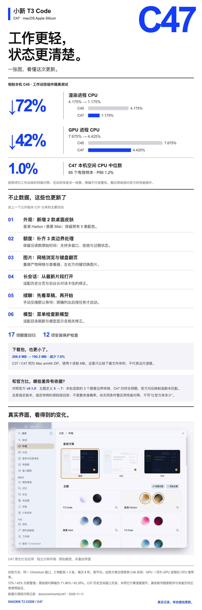
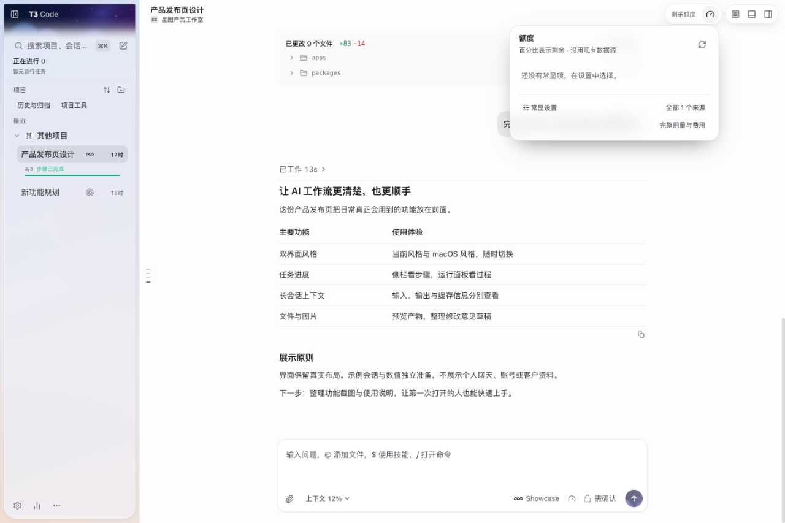
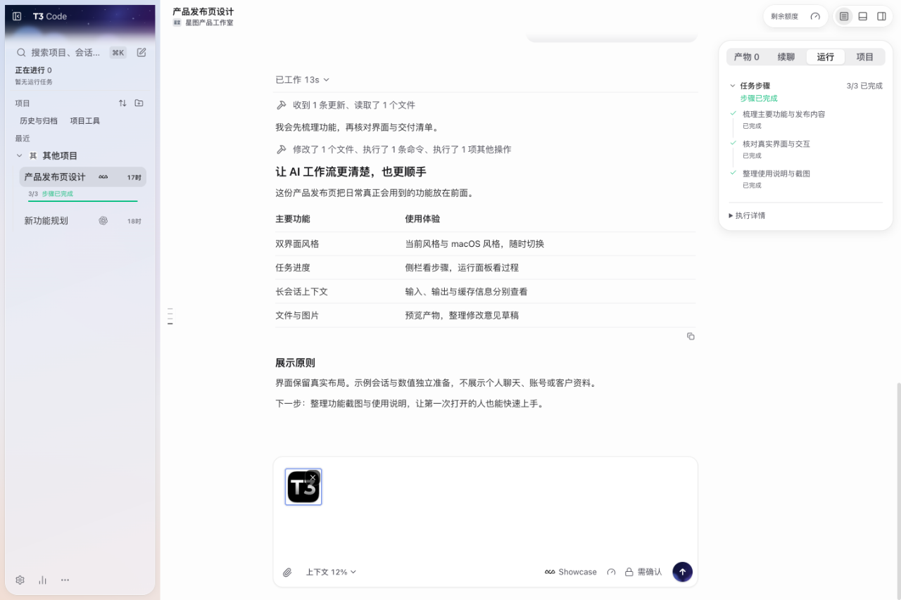
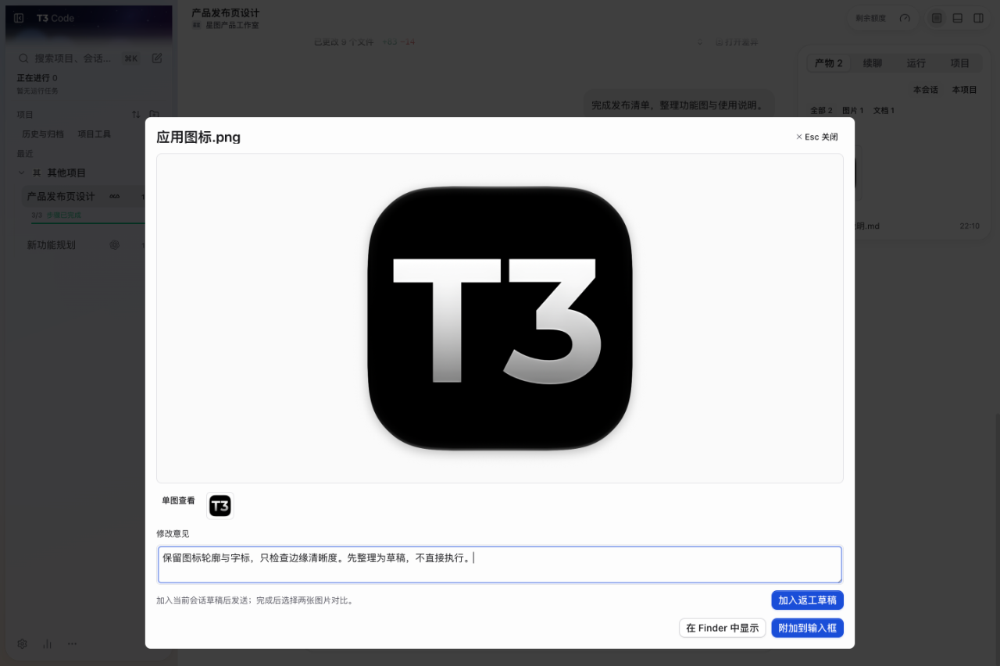
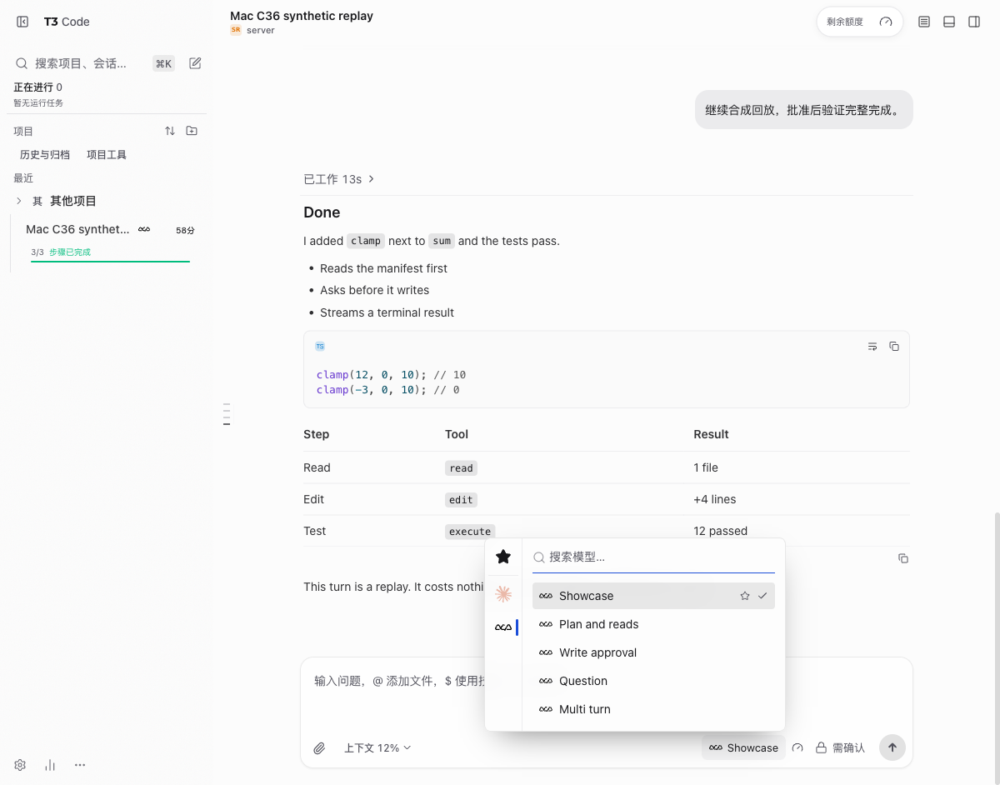
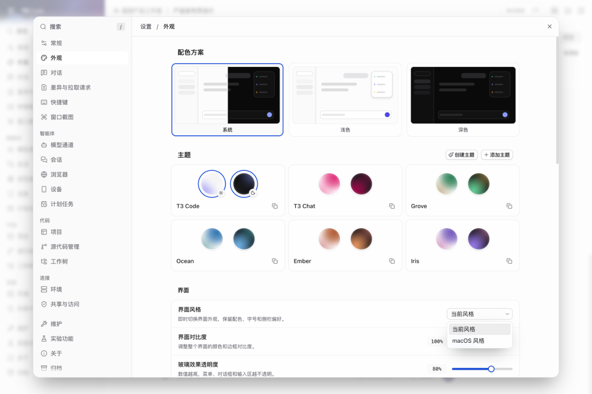

# Xiaoxin T3 Code · Community Edition

**Current community release: C47 · quota fixes, lighter motion and two desktop skins.** For Apple Silicon Mac.

[Download C47 · macOS Apple Silicon](https://github.com/zds-xiaoxin/xiaoxin-t3code/releases/latest) · [Installation and validation scope](docs/community/c47/RELEASE.en.md) · [简体中文](README.md)

C47 is the community release number; embedded upstream version remains `0.1.7-nightly.20261103.4119` with selected later fixes, not upstreamv0.1.9. Current source, installer and build provenance are supplied together.

<!-- showcase:overview -->

_C47 release card: measured data, concrete changes and an authentic screenshot of the application extracted from the actual ZIP. Previous gallery images remain version-labelled._

## C47 update: lighter motion, more reliable quota state

**C47 source, downloadable installer and build provenance are updated together.** Its embedded upstream version remains `0.1.7-nightly.20261103.4119` with selected later patches. It does not claim to be upstream stable `v0.1.9`.

_White/black/cobalt release card with data-exact plots and an authentic native screenshot. The two reductions describe an isolated activity-strip component, not whole-app, whole-system or upstream-relative performance._

| Compared with local C45             |    C45 | C47 implementation |           Change |
| ----------------------------------- | -----: | -----------------: | ---------------: |
| Working strip: mean renderer CPU    | 4.175% |             1.175% | **71.86% lower** |
| Working strip: mean GPU-process CPU | 7.675% |             4.425% | **42.35% lower** |

Same headful Chromium window; two skins × two rounds; 8 seconds per sample; mean of four samples per version. GPU-process CPU is not GPU utilization. C47 public client assets were rebuilt from final source; normalized component CSS and logic retain the measured implementation. Separately, the installed C47 renderer passed an idle window of 65 samples: median **1.0%**, P95 **1.2%**. These are different workloads.

### Previous public C37 → C47

| Item                              | Published C37 evidence                       | C47 evidence                                                             |
| --------------------------------- | -------------------------------------------- | ------------------------------------------------------------------------ |
| Additional desktop skins          | No Harbor / Mist                             | **2 new skins**, retaining the five original palettes                    |
| Strict idle CPU window            | Input observations made validity unconfirmed | **65 valid samples passed**                                              |
| New Claude events and stale cache | This fix was not included                    | Observation time, multiple windows, rejection and stale startup handling |

The C37 idle window cannot be compared with the current idle result to claim an 80% whole-app reduction. Test counts are not speed measurements.

### Compared with upstream v0.1.9

| Verifiable item                                                               | Upstream v0.1.9 |                                    C47 |
| ----------------------------------------------------------------------------- | --------------: | -------------------------------------: |
| Predefined themes in the compared theme directory                             |               5 |            **7, adding Harbor / Mist** |
| The three selected quota boundary fixtures produce the expected mapper result |           0 / 3 |                              **3 / 3** |
| Matched whole-app CPU / throughput benchmark                                  |    Not measured | **No claim of outperforming upstream** |

Fixtures cover unified windows without top-level utilization, a rejected event without utilization, and a six-minute-old startup reading. This compares the corresponding pure mappers, not overall provider accuracy, upstream's complete test suite or a live-account end-to-end workflow. Upstream v0.1.9 was published on 2026-11-11; C47 does not claim that core version.

[Methods, raw numbers and falsification criteria](docs/community/c47/BENCHMARK.en.md) · [Public measurement data](docs/community/c47/measurements.json)

[Open the original native screenshot embedded in the card](assets/community/c47/02-themes-native.png)

_Unedited packaged native C47 capture with an isolated fixture and no private accounts, balances or chats. All nine previous feature illustrations remain below, with their original version labels._

### Historical C37 workbench overview

_Actual C37 compiled UI with an isolated fixture, retained as historical feature coverage. Current C47 changes are shown in the card above._

## See the workbench features

The C37 overview, quota, task, image preview, context and style settings are unedited screenshots of the actual compiled web UI with isolated synthetic data. Earlier real runtime captures for models, usage and storage remain version-labelled. Web captures are not presented as native-window captures.

<!-- showcase:allowances -->

### Quota menu and pinned-display settings

Open the header quota panel and choose pinned items. This capture shows its real empty state without personal accounts; available items and reporting windows depend on each connected provider.

_Actual C37 quota panel; the demo has no linked personal accounts or invented balances._

<!-- showcase:progress -->

### Task steps and sidebar progress

See completion counts and the current stage in the sidebar, then open the full step list in Run. Running, waiting for confirmation and completed states remain distinct.

_Actual C37 sidebar/run panel with synthetic replay steps and status._

<!-- showcase:artifacts -->

### Image preview and revision-comment drafts

Review outputs, enlarge an image and prepare revision comments before sending them. The screenshot shows single-image viewing and an unsent comment draft; the separate two-image comparison flow is not illustrated here.

_Actual C37 artifact image viewer and revision-comment draft using the public app icon; nothing was sent or regenerated._

<!-- showcase:context -->

### Long-conversation context

Inspect context occupancy, input/output, and cache reads/writes for the active session. Missing counters show ?, while reported zeros remain 0. Continue in a new conversation when needed.

_Actual C37 context panel; token/cache values are synthetic replay data, not personal usage or measured savings._

<!-- showcase:models -->

### A compact model picker

Search, favorite and switch models without a permanent default-settings footer.

_Compiled C36 Mac candidate UI with the free replay provider. Model parameters open separately; available models depend on the configured provider._

<!-- showcase:usage -->

### Usage, cost and tokens

Inspect time ranges and model breakdowns with separate cost and token metrics.

_C28 isolated-runtime screenshot with synthetic usage. Costs are API estimates, not a subscription bill or payment record._

<!-- showcase:storage -->

### Scoped storage management

Inspect workspaces, dependencies, builds and logs by volume and category. Preview a specific plan before acting on eligible items.

_C28 isolated-runtime screenshot with fixture directories. Occupancy is not reclaimable space; the archive worker currently supports macOS._

<!-- showcase:settings -->

### Two interface styles and Chinese settings

Choose Current style or macOS style in Appearance → Interface; colors, font sizes and sidebar preferences remain independent. Chinese categories, search and guidance cover daily settings; English is also supported.

_Actual C37 Chinese Appearance settings showing Current style / macOS style._

## Download and use

- **C47 · Apple Silicon Mac:** [download the latest ZIP](https://github.com/zds-xiaoxin/xiaoxin-t3code/releases/tag/xiaoxin-c47-macos-20261111), verify SHA256SUMS.txt and read the [installation/provenance notes](docs/community/c47/RELEASE.en.md). Updates are manual.
- **Previous public Mac C37:** [historical release](https://github.com/zds-xiaoxin/xiaoxin-t3code/releases/tag/xiaoxin-c37-macos-test-20261103). C47schema79 supersedes C37schema78; do not open upgraded data with the older app.
- **Earlier Mac C31:** [history and rollback reference](https://github.com/zds-xiaoxin/xiaoxin-t3code/releases/tag/xiaoxin-c31-20261031). Never overwrite new chats with an old database.
- **Windows x64:** [existing C35-W2 test release](https://github.com/zds-xiaoxin/xiaoxin-t3code/releases/tag/xiaoxin-c35-windows-test-20261102). No new C47Windows,IntelMac orLinux binary is claimed.
- Finish tasks,quit completely,make a cold backup and retain the previous app before upgrading. Users supply their own provider CLI/login. No maintainer personal data is included.
- Ad-hoc signed,not Apple-notarized. Follow macOS Privacy&Security prompts; do not disable system-wide protections or grant FullDiskAccess merely to install.

## Verification and known limits

The C47 ZIP is190.3decimalMB versus publicC37's206.0MB(-7.62%), same architecture/archive format,not runtime speed. CRC,164regular-file hashes/modes,14symlink targets,extracted strict signature,privacy scanning and isolated native startup passed. The native PTY loaded and spawned a fixture shell.

[Release validation](docs/community/c47/RELEASE.en.md) · [Methods and reproducible fixtures](docs/community/c47/BENCHMARK.en.md) · [Live source CI](https://github.com/zds-xiaoxin/xiaoxin-t3code/actions/runs/43033315668). No real account or paid model was used in this distribution acceptance. Live quota exhaustion/reset and optional T3Connect login remain separately scoped.

## History and upstream

Older releases remain available for history and rollback. Use the recommended download above for everyday use.

[All releases](https://github.com/zds-xiaoxin/xiaoxin-t3code/releases) · [C30 notes](docs/community/c30/RELEASE.en.md) · [C29 notes](docs/community/c29/RELEASE.en.md) · [C28 notes](docs/community/C28.en.md) · [Upstream T3 Code](https://github.com/pingdotgg/t3code)
