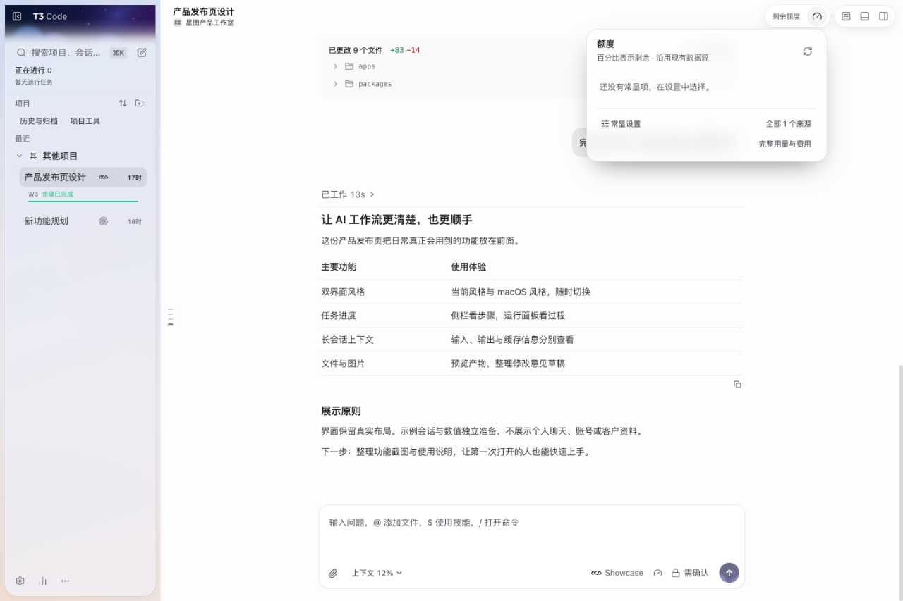
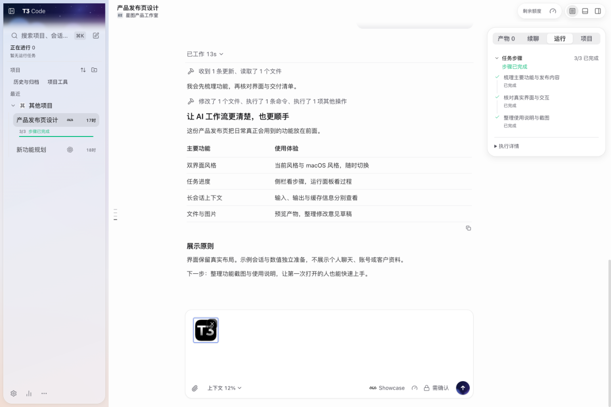
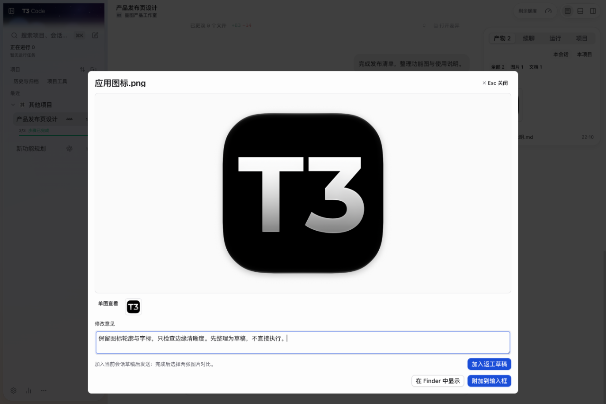
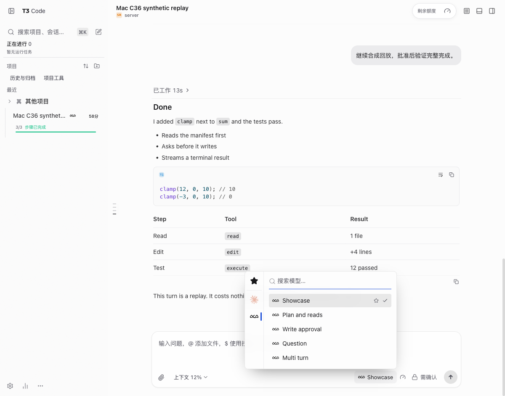
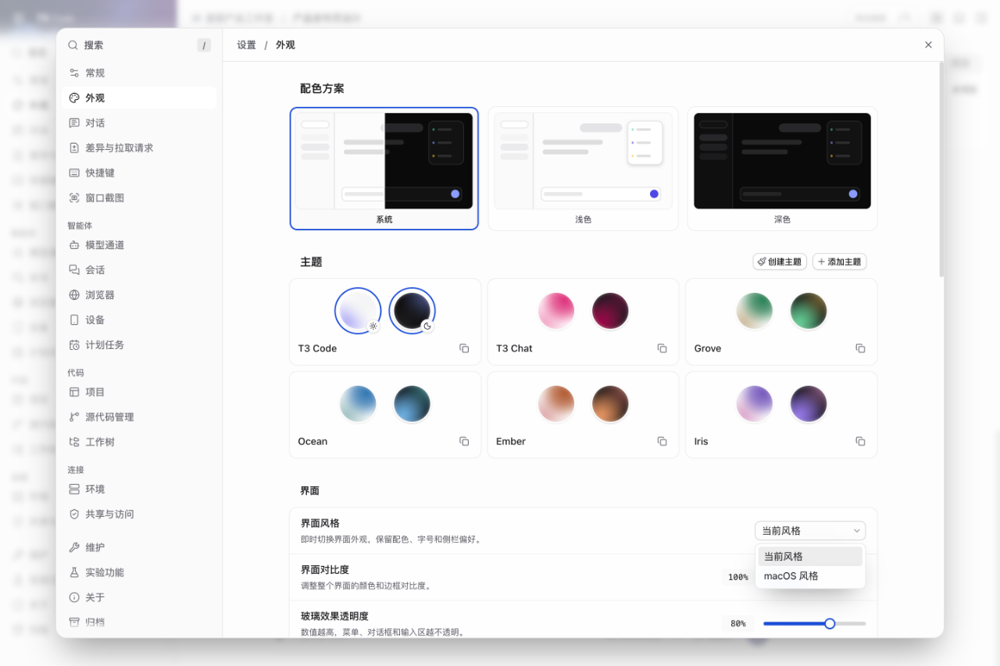

# Xiaoxin T3 Code · 小新定制版

**当前社区正式版：C37 · 双界面风格。** 在「外观 → 界面」切换当前风格 / macOS 风格；适用于 Apple Silicon Mac。

[下载 C37 · macOS Apple Silicon](https://github.com/zds-xiaoxin/xiaoxin-t3code/releases/latest) · [安装与验证范围](docs/community/c37/RELEASE.zh.md) · [English](README.en.md)

C37 是小新社区发行编号，基于上游 `0.1.7-nightly.20261103.4119`。社区正式发布与上游的版本通道分别标注；已知限制见发行说明。

<!-- showcase:overview -->

_C37 实际编译界面，使用独立示例项目与对话；截图未重绘。_

## 特色功能，看图了解

图片直接展示，点击可放大。总览、额度、任务、图片预览、上下文与双风格设置来自 C37 的实际编译界面，使用独立示例数据，未重绘界面。模型、费用与磁盘图保留已有真实运行截图，并标注版本。网页截图不冒充原生窗口截图。

<!-- showcase:allowances -->

### 额度入口与常显设置

从右上角打开额度面板并配置常显项。此截图展示未连接个人账号时的真实空状态；连接后可显示的项目和时间窗口以供应商返回为准。

_C37 实际额度面板；示例环境未连接个人账号，不展示虚构余额。_

<!-- showcase:progress -->

### 任务步骤与侧栏进度

侧栏直接看到完成数和当前阶段，运行面板查看完整步骤，区分执行中、等待确认与已完成。

_C37 实际侧栏与运行面板，步骤和状态为独立回放示例。_

<!-- showcase:artifacts -->

### 文件与图片，直接预览

集中查看产物、放大图片，并将修改意见整理为草稿，由你发送后继续处理。下图展示单图查看与意见草稿；双图对比是独立入口，此图没有演示。

_C37 实际产物图片查看器与修改意见草稿，使用公开应用图标；没有发送草稿或执行返工。_

<!-- showcase:context -->

### 长会话上下文

查看当前会话的上下文占用、输入与输出、缓存读取与写入；未上报的值显示为 ?，真实零值保留为 0。需要时可交接到新会话。

_C37 实际上下文面板；令牌与缓存为独立回放示例，不是个人消耗或节省率。_

<!-- showcase:models -->

### 更紧凑的模型选择

保留模型搜索、收藏和切换，减少模型菜单底部的常驻设置。

_C36 Mac 候选的编译界面，使用免费回放通道；模型参数独立展开，可选模型以实际配置为准。_

<!-- showcase:usage -->

### 用量、费用与令牌各自清楚

按时间和模型查看用量，费用模式与令牌模式使用各自的指标和占比。

_C28 隔离环境实拍，使用合成用量；金额为 API 估算，不是订阅账单或扣款记录。_

<!-- showcase:storage -->

### 有范围的磁盘整理

按磁盘和类别查看工作区、依赖、构建产物与日志，先检查和预览具体计划，再处理符合条件的项目。

_C28 隔离环境实拍，目录为测试数据；占用不等于可释放量。归档执行器目前支持 macOS。_

<!-- showcase:settings -->

### 双界面风格与中文设置

在「外观 → 界面」选择当前风格或 macOS 风格，即时切换并保留配色、字号和侧栏偏好。中文分类、搜索和说明覆盖日常设置。

_C37 实际中文外观设置，展示当前风格 / macOS 风格两个选择。_

## 下载与使用

- **C37 社区正式版：** [下载 Apple Silicon ZIP](https://github.com/zds-xiaoxin/xiaoxin-t3code/releases/tag/xiaoxin-c37-macos-test-20261103)，查看 [C37 安装说明](docs/community/c37/RELEASE.zh.md)。仅手动更新；使用过 C37 的数据请继续用兼容新版，不能直接改用下方 C31。
- **旧正式版 C31 · Mac Apple Silicon：** 从 [C31 历史发行页](https://github.com/zds-xiaoxin/xiaoxin-t3code/releases/tag/xiaoxin-c31-20261031) 获取 `Xiaoxin-T3-Code-C31-macOS-arm64.zip`，核对页面提供的 SHA-256。
- **Windows x64：** [C31-W1 测试版](https://github.com/zds-xiaoxin/xiaoxin-t3code/releases/tag/xiaoxin-c31-windows-test-20261031) · [Windows 源码与示意图](https://github.com/zds-xiaoxin/xiaoxin-t3code/tree/community/windows-c31-w1)。Windows 测试版与 Mac 正式推荐版分别发布。
- 替换 Mac 应用前请结束任务并退出 T3，保留旧应用供回退。不要删除或重置聊天、登录和配置目录；各模型使用你自己的 CLI 与登录。
- Mac 包为 ad-hoc 签名，尚未经过 Apple 公证。适用平台、安装方法和验证范围分别见对应的 C37 / C31 说明。

## 验证与已知事项

C37 的双风格、打包与验收范围见 [C37 验证说明](docs/community/c37/RELEASE.zh.md)；严格空闲 CPU 窗口仍待确认。

以下验证仅适用于旧正式版 C31：其应用文件与维护者当时在用的 C31 逐文件一致。相同应用已经通过 Mac 新会话第一轮、同会话第二轮无需刷新回复，以及先前失败会话读回验证；本次发布副本另通过隔离启动、签名、ZIP 完整性和文件哈希核对。

233 个相关测试、20 项 React Compiler 检查、7 个包类型检查通过。源码仍有格式、lint 和 knip 遗留项，全部列在 [C31 说明](docs/community/c31/RELEASE.zh.md)。当前推荐发行状态不代表所有供应商、所有尺寸或所有场景均已验证。

## 历史与来源

旧版本仅保留作历史和回退参考，日常下载请使用页面顶部的当前推荐版。

[全部历史发行](https://github.com/zds-xiaoxin/xiaoxin-t3code/releases) · [C30 更新记录](docs/community/c30/RELEASE.zh.md) · [C29 更新记录](docs/community/c29/RELEASE.zh.md) · [C28 更新记录](docs/community/C28.md) · [上游 T3 Code](https://github.com/pingdotgg/t3code)
