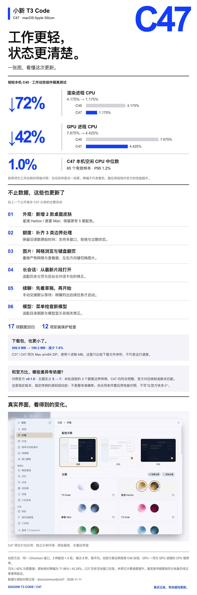

# Xiaoxin T3 Code C47 · Mac Apple Silicon community release

2026-11-11 · macOS arm64 · [简体中文](RELEASE.zh.md)

<!-- community-showcase -->

[完整功能图集 / Full feature gallery](https://github.com/zds-xiaoxin/xiaoxin-t3code#feature-showcase)
<!-- /community-showcase -->

Download **`Xiaoxin-T3-Code-C47-macOS-arm64.zip`** (190.3 decimal MB), verify it with SHA256SUMS.txt, and extract T3 Code (Alpha).app. BUILD-PROVENANCE.json binds source, archive and validation scope. Source: [9058ea87621b](https://github.com/zds-xiaoxin/xiaoxin-t3code/commit/9058ea87621b2abf9d602694972a54afbd48a9d1). Embedded upstream version remains 0.1.7-nightly.20261103.4119 with selected later fixes, not upstreamv0.1.9.

Changes include stale Claude quota observation time, unified windows/rejection events, unavailable stale startup readings, compositor-based activity glint, Harbor/Mist skins, the artifact grid/viewer and arrow navigation. Since public C37, selected long-thread paging, background-thread, model-catalog and manual-handoff fixes are included. The annotated read-only memory_list tool now matches the unchanged equality assertion.

Recorded component A/B means: renderer CPU4.175→1.175%(-71.86%), GPU-process CPU7.675→4.425%(-42.35%), two skins×two8s observations in one window. These are isolated component measurements, not GPU utilization or whole-app/upstream performance. Final web assets were rebuilt and differ in hash; normalized component CSS and logic remain equivalent. Local installed C47 idle evidence was65samples,median1.0%,P951.2%, a separate workload/build and not a guarantee for this public rebuild or every device. The archive shrank from C37's205,956,114bytes to190,264,771bytes(-7.62%), same architecture and ditto ZIP format; this is download size, not runtime speed.

Apple Silicon only; declared minimum macOS13.0, not every OS version tested. No new Intel/Windows/Linux binary. Users supply their own provider CLI and login; no maintainer account, profile, credential or installer helper is included. Before upgrading, finish tasks, quit completely, retain the old app and cold-back up ~/.t3 and ~/Library/Application Support/t3code-v2. C47schema79 supersedes public C37schema78. Never open upgraded data with an incompatible old app or overwrite new chats with an old database.

Ad-hoc signed, not Apple notarized. Use macOS Privacy & Security prompts if needed; do not disable system-wide protections or grant Full Disk Access just to install. Updates are manual; the upstream automatic feed is disabled in this distribution.

ZIP CRC, all164regular-file hashes/modes and14symlink targets, and extracted deep/strict signature passed.2124privacy-scanned entries had no maintainer paths/accounts/credentials. Only node-pty debug symbols were removed; native code/data sections, exports and architecture were verified unchanged. The actual extracted application passed isolated native startup, both skins,HTTP200,and native PTY load/fixture-shell execution with no real account/model request.17quota regressions and12installer-protection checks overlap other sets and must not be added as a coverage score. [Source CI](https://github.com/zds-xiaoxin/xiaoxin-t3code/actions/runs/43033315668) is reported independently; unfinished jobs are not claimed passed. Live-account exhaustion/reset observation and optional T3 Connect/passkey validation remain outside this pass.

SHA256: `e01b473a9efbfcd19fdd6cd9291108a8dc41825707d31a0e51a7bbefd0fe82ca`. [Previous C37](https://github.com/zds-xiaoxin/xiaoxin-t3code/releases/tag/xiaoxin-c37-macos-test-20261103) and all previous gallery images remain available.
