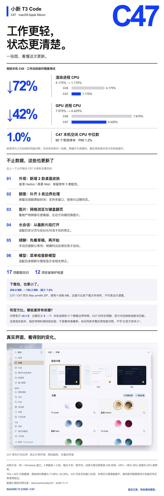

# Xiaoxin T3 Code C47 · Mac Apple Silicon 社区版

2026-11-11 · macOS arm64 · [English](RELEASE.en.md)

<!-- community-showcase -->

  
   
  <a href="https://raw.githubusercontent.com/zds-xiaoxin/xiaoxin-t3code/main/assets/community/c47/01-update-card-A.png">点击查看完整更新长图</a>

[完整功能图集 / Full feature gallery](https://github.com/zds-xiaoxin/xiaoxin-t3code#feature-showcase)
<!-- /community-showcase -->

## 下载什么

下载本页 **`Xiaoxin-T3-Code-C47-macOS-arm64.zip`**（190.3 MB，十进制），按 `SHA256SUMS.txt` 校验 SHA-256。解压得到 `T3 Code (Alpha).app`。同页 `BUILD-PROVENANCE.json` 绑定源码提交、包哈希和验证范围。

源码提交：[`9058ea87621b`](https://github.com/zds-xiaoxin/xiaoxin-t3code/commit/9058ea87621b2abf9d602694972a54afbd48a9d1)。C47 为社区编号；内嵌上游版本仍为 `0.1.7-nightly.20261103.4119`，并定向适配后续修正，不能等同于官方 v0.1.9。

## 这次改了什么

- **额度读数**：保留匹配缓存的原始观察时间，避免旧百分比覆盖较新的耗尽状态；处理多窗口和拒绝事件，标记过期启动读数。
- **工作动效**：高光通过合成层移动，减少文字逐帧重绘；保留进出场、进度与完成反馈。
- **外观与图片**：新增星港 / 晨雾两款桌面皮肤，产物网格和图片查看器支持方向键翻页。
- **长会话与续聊**：包括历史分页、后台长对话、模型目录刷新和手动交接先草稿后启动的适配。
- **只读工具一致性**：补齐已声明只读的 `memory_list`，原清单一致性测试通过，未弱化断言。

## 有范围的数据对比

| 项目                  |         之前 |                   本次 | 范围                                |
| --------------------- | -----------: | ---------------------: | ----------------------------------- |
| 工作动效渲染进程 CPU  |       4.175% |      1.175%（-71.86%） | C45 对比受测优化组件，4 次8秒均值   |
| 工作动效 GPU 进程 CPU |       7.675% |      4.425%（-42.35%） | 同一窗口、两种配色；不是 GPU 利用率 |
| Mac arm64 ZIP 体积    | C37 206.0 MB | C47 190.3 MB（-7.62%） | 同架构、同为 ditto ZIP；十进制MB    |

这些动效数据来自已记录的组件隔离实验。最终公开包已从修正源码重新构建，资产哈希不同；动效组件的格式归一化 CSS 和逻辑保持一致，不把它说成整应用或相对官方的提速。

本机已安装 C47 的严格空闲窗口有65个有效样本，中位数1.0%、P951.2%；这属于另一场景与已记录构建，不保证所有设备或本次重建包得到同值。官方 v0.1.9 对照只涵盖指定主题定义和3个纯映射边界样例，不是整体准确率。方法、原始数据和复现实例在仓库 `docs/community/c47`。

## 安装、升级与回退

1. 仅支持 Apple Silicon Mac；应用声明最低 macOS13.0，本轮未覆盖所有系统版本。没有本轮 Intel / Windows / Linux 安装包。
2. 新用户移入“应用程序”后使用自己的模型 CLI、账号和配置；包内没有维护者账号、聊天、密钥或独立安装助手。
3. 升级用户先结束任务、完全退出 T3，冷备份 `~/.t3` 与 `~/Library/Application Support/t3code-v2`，保留旧 App，再替换；只运行一个实例。
4. C47 数据库为schema79，旧公开 C37 为schema78。**不要让旧 App 直接读取升级后的数据，也不要用旧库覆盖升级后产生的新聊天。** 回退须使用匹配版本和同时点备份。
5. 发布包采用 ad-hoc 签名，未经过 Apple 公证。遇系统拦截时按 macOS“隐私与安全性”提示处理，不需要关闭系统整体安全保护或授予完全磁盘访问。
6. **本发行采用手动更新**；上游自动更新源已在公开副本中禁用，防止覆盖社区定制。继续从本仓库下载新版。

## 验证与限制

ZIP CRC、164个普通文件内容和权限、14个符号链接目标，以及解压后深度严格签名均通过。隐私扫描2124个条目未发现维护者私有路径、账号或凭据；node-pty只移除了调试符号，代码段、导出和架构核验一致。解压后的实际应用完成隔离原生启动、双主题切换、HTTP200及终端原生模块加载/示例 shell 验证，未调用真实模型、未使用真实账号。

额度17项回归与安装保护12项检查属于不同范围；与其他测试集有重叠，不相加宣传覆盖率。源码CI状态请看[本次源码检查](https://github.com/zds-xiaoxin/xiaoxin-t3code/actions/runs/43033315668)，本说明不把尚未结束的作业写成已通过。真实账号额度耗尽/恢复仍待正常使用观察；T3 Connect登录和通行密钥未重新验收。

[C37 历史发行](https://github.com/zds-xiaoxin/xiaoxin-t3code/releases/tag/xiaoxin-c37-macos-test-20261103)保留，图片图库继续展示并标注版本。C47 包SHA256：`e01b473a9efbfcd19fdd6cd9291108a8dc41825707d31a0e51a7bbefd0fe82ca`。
